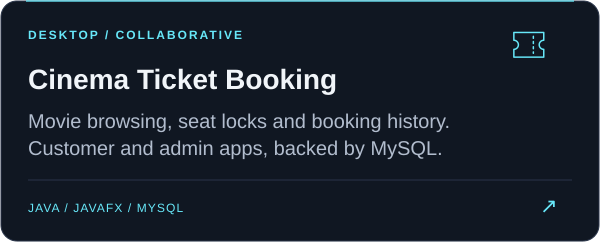
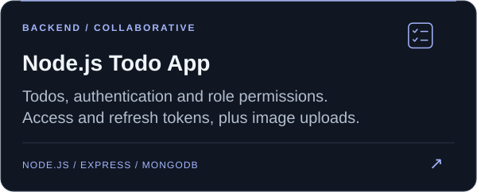
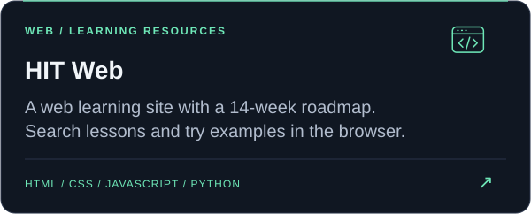
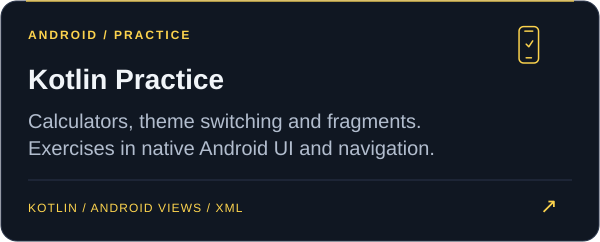

  

  

  <a href="#selected-projects">Projects</a> &nbsp; / &nbsp;
  <a href="#tech-stack">Tech stack</a> &nbsp; / &nbsp;
  <a href="#activity">Activity</a> &nbsp; / &nbsp;
  <a href="https://github.com/vanphuoc0443?tab=repositories">All repositories</a>

I'm Phước. I build web applications with React, TypeScript, and Node.js, and Android apps with Kotlin. I also work with Java and JavaFX.

My public work includes a cinema booking system, a Node.js todo app, and a web learning site. Some of my React and Android projects are private; the projects below are open to explore.

<h2 id="selected-projects">Selected projects</h2>

  
  
  
  

  
Project details and collaborators

  <ul>
    <li><a href="https://github.com/vanphuoc0443/CinemaTicketBooking">Cinema Ticket Booking</a>, built with <a href="https://github.com/minh656512-debug">minh656512-debug</a>: customer and admin apps, temporary seat locks, booking transactions, showtime conflict checks, and movie details from OMDb.</li>
    <li><a href="https://github.com/vanphuoc0443/HIT_NODEJS_TodoApp">Node.js Todo App</a>, a collaborative project with <a href="https://github.com/HuyHoang3425">HuyHoang3425</a>: input validation, access and refresh tokens, role permissions, and Cloudinary uploads.</li>
    <li><a href="https://github.com/vanphuoc0443/HIT_WEB">HIT Web</a>: a 14-week HTML, CSS, and JavaScript roadmap, searchable lessons, light and dark themes, and pages generated from Markdown.</li>
    <li><a href="https://github.com/vanphuoc0443/HIT_Android">Kotlin Practice</a>: Android Views and XML exercises with calculator logic, theme switching, and fragment-based login and password recovery screens.</li>
  </ul>

<h2 id="tech-stack">Tech stack</h2>

<h3>Web</h3>

  <a href="https://skillicons.dev">
    <picture>
      <source media="(prefers-color-scheme: light)" srcset="https://skillicons.dev/icons?i=ts,js,react,nodejs,express,mongodb,html,css&amp;theme=light&amp;perline=8" />
      
    </picture>
  </a>

I use Vite for React projects and Playwright for browser tests.

<h3>Android &amp; Java</h3>

  <a href="https://skillicons.dev">
    <picture>
      <source media="(prefers-color-scheme: light)" srcset="https://skillicons.dev/icons?i=kotlin,androidstudio,java,mysql&amp;theme=light&amp;perline=4" />
      
    </picture>
  </a>

On Android, I've used Jetpack Compose, Room, Hilt, and WorkManager. My desktop work uses JavaFX, MySQL, and Maven.

  
Earlier practice

  
My earlier repositories cover HTML/CSS layouts and Java fundamentals, including arrays, methods, and basic account operations.

<h2 id="activity">Activity</h2>

<!-- SNAKE:START -->

<a href="https://github.com/vanphuoc0443?tab=overview">View my contribution history on GitHub</a>

<!-- SNAKE:END -->

  <a href="https://github.com/vanphuoc0443?tab=repositories">Explore the code</a>

