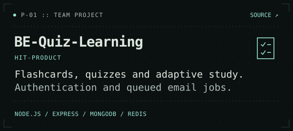
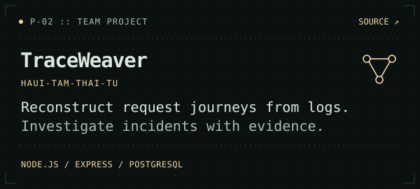

  

  

  <a href="#selected-projects">Projects</a> &nbsp; / &nbsp;
  <a href="#tech-stack">Tech stack</a> &nbsp; / &nbsp;
  <a href="#activity">Activity</a> &nbsp; / &nbsp;
  <a href="https://github.com/vanphuoc0443?tab=repositories">All repositories</a>

I'm Phước. I work with JavaScript, Node.js, and Express, and build Android apps with Kotlin. I also use Java and JavaFX.

I contribute to team projects focused on learning platforms and log-based incident investigation.

<h2 id="selected-projects">Selected projects</h2>

  
  

  
Project details and collaborators

  <ul>
    <li><a href="https://github.com/HIT-Product/BE-Quiz-Learning">BE-Quiz-Learning</a>, with the <a href="https://github.com/HIT-Product">HIT-Product</a> team: a Node.js, Express, and MongoDB API for flashcards, quizzes, and learning sessions. The backend includes JWT and Google OAuth authentication, with Redis and BullMQ for email jobs.</li>
    <li><a href="https://github.com/HaUI-Tam-Thai-Tu/TraceWeaver">TraceWeaver</a>, with the <a href="https://github.com/HaUI-Tam-Thai-Tu">HaUI-Tam-Thai-Tu</a> team: an open-source platform that reconstructs request journeys from logs across sources. It supports evidence-backed incident cases, access controls, and sandbox verification, with a Node.js/Express backend and PostgreSQL.</li>
  </ul>

<h2 id="tech-stack">Tech stack</h2>

<h3>JavaScript &amp; backend</h3>

  <a href="https://skillicons.dev">
    <picture>
      <source media="(prefers-color-scheme: light)" srcset="https://skillicons.dev/icons?i=js,nodejs,express,mongodb,html,css&amp;theme=light&amp;perline=6" />
      
    </picture>
  </a>

I also use Playwright for browser tests.

<h3>Android &amp; Java</h3>

  <a href="https://skillicons.dev">
    <picture>
      <source media="(prefers-color-scheme: light)" srcset="https://skillicons.dev/icons?i=kotlin,androidstudio,java,mysql&amp;theme=light&amp;perline=4" />
      
    </picture>
  </a>

On Android, I've used Jetpack Compose, Room, Hilt, and WorkManager. My desktop work uses JavaFX, MySQL, and Maven.

  
Earlier practice

  
My earlier repositories cover HTML/CSS layouts and Java fundamentals, including arrays, methods, and basic account operations.

<h2 id="activity">Activity</h2>

<!-- SNAKE:START -->

<a href="https://github.com/vanphuoc0443?tab=overview">View my contribution history on GitHub</a>

<!-- SNAKE:END -->

  <a href="https://github.com/vanphuoc0443?tab=repositories">Explore the code</a>

