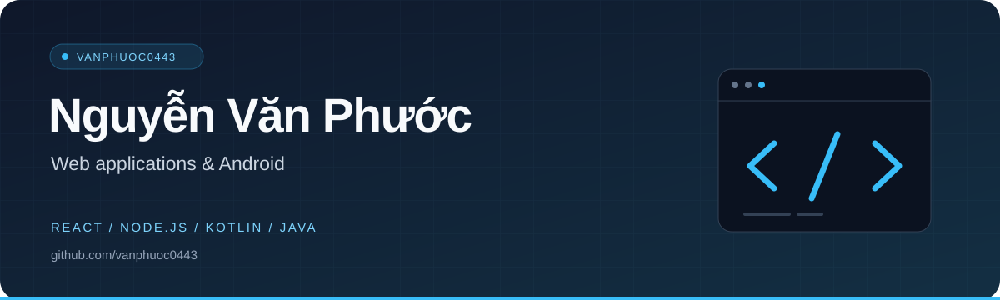

  

  

  
  

## A little about me

I'm Phước. I build web applications with React, TypeScript, and Node.js, and Android apps with Kotlin. I also work with Java and JavaFX.

My public work includes a collaborative cinema booking system, a Node.js todo app, and a web learning site. Some of my React and Android projects are private; the repositories below are open to explore.

## Tools I work with

  <a href="https://skillicons.dev">
    <picture>
      <source media="(prefers-color-scheme: light)" srcset="https://skillicons.dev/icons?i=ts,js,react,nodejs,express,mongodb,html,css&amp;theme=light&amp;perline=8" />
      
    </picture>
  </a>

  <a href="https://skillicons.dev">
    <picture>
      <source media="(prefers-color-scheme: light)" srcset="https://skillicons.dev/icons?i=kotlin,androidstudio,java,mysql&amp;theme=light&amp;perline=4" />
      
    </picture>
  </a>

On Android, I've used Jetpack Compose, Room, Hilt, and WorkManager. My Java desktop work uses JavaFX, MySQL, and Maven. I also use Vite for React projects and Playwright for browser tests.

## Selected projects

### [Cinema Ticket Booking](https://github.com/vanphuoc0443/CinemaTicketBooking)

A cinema booking app I built with [minh656512-debug](https://github.com/minh656512-debug). Customers can browse movies, select seats, book tickets, and review their booking history. A separate admin app manages movies and showtimes.

The code includes temporary seat locks, booking transactions, and checks for scheduling conflicts. Both apps share a MySQL database, with movie details from the OMDb API.

`Java` `JavaFX` `MySQL` `Maven` `OMDb API`

### [Node.js Todo App](https://github.com/vanphuoc0443/HIT_NODEJS_TodoApp)

A collaborative Express and MongoDB project with [HuyHoang3425](https://github.com/HuyHoang3425). Alongside todo management, its backend includes login, access and refresh tokens, role and permission management, input validation, and file uploads through Cloudinary.

`JavaScript` `Node.js` `Express` `MongoDB` `JWT` `Cloudinary`

### [HIT Web](https://github.com/vanphuoc0443/HIT_WEB)

A web learning site with a 14-week roadmap covering HTML, CSS, and JavaScript. The site includes lesson search, light and dark themes, and an editor for trying code examples in the browser. Python scripts generate the lesson pages from Markdown.

`HTML` `CSS` `JavaScript` `Python`

## Practice repositories

[HIT Android](https://github.com/vanphuoc0443/HIT_Android) contains my Kotlin exercises, including calculator logic, theme switching, and fragment-based authentication screens. My earlier repositories cover HTML/CSS layouts and Java fundamentals such as arrays, methods, and basic account operations.

## Contributions

<!-- SNAKE:START -->
[View my contribution history](https://github.com/vanphuoc0443?tab=overview)
<!-- SNAKE:END -->

  <a href="https://github.com/vanphuoc0443?tab=repositories">Browse all repositories</a>

